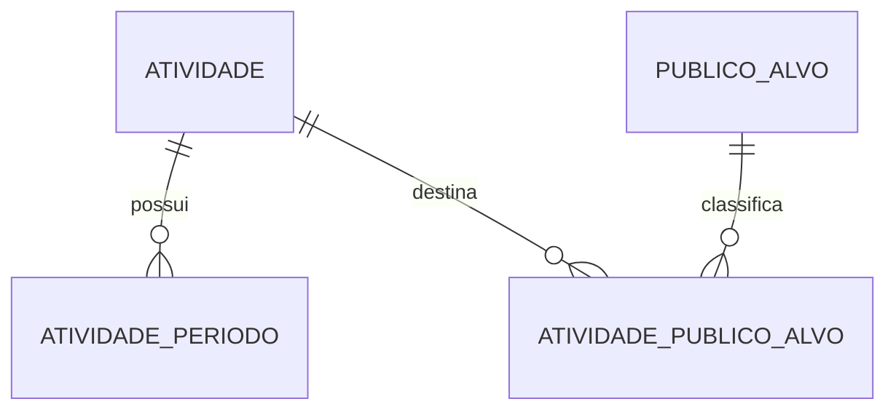
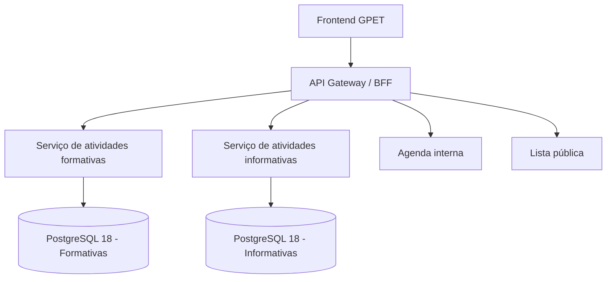
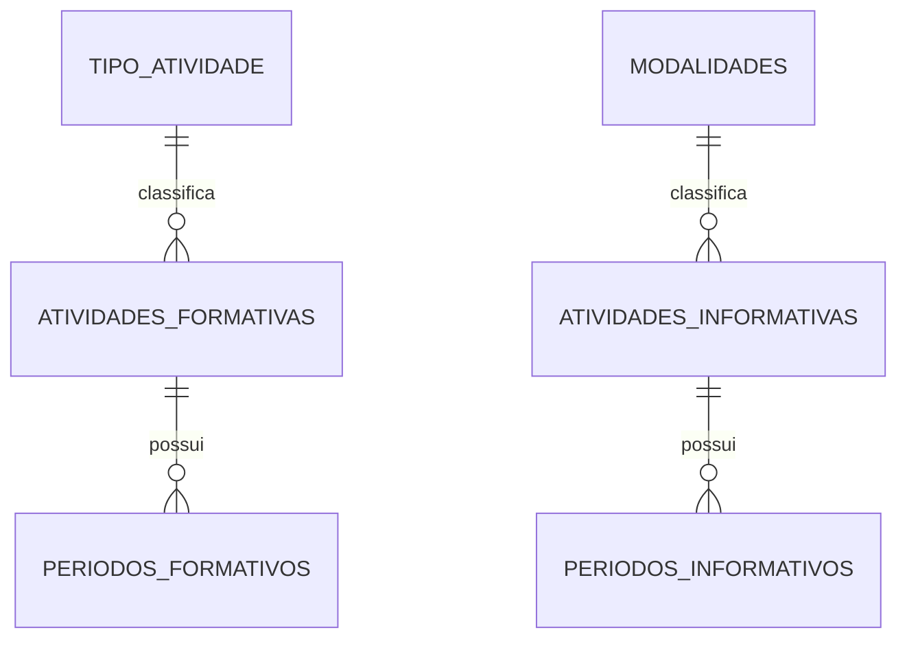
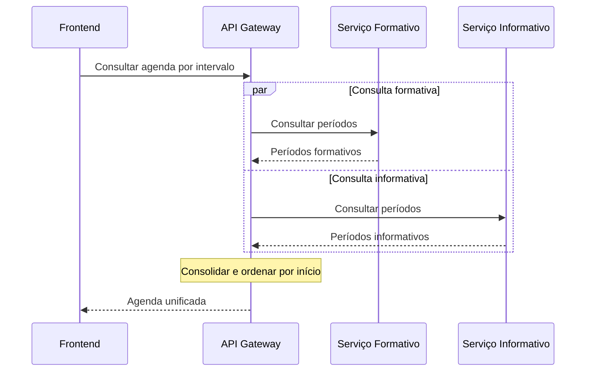

# GPET — Modelagem de atividades formativas, informativas e agenda

**Data da sessão:** 25 de novembro de 2026  
**SGBD:** PostgreSQL 18  
**Formato:** registro técnico consolidado da sessão de discussão

> Este documento reúne as perguntas, as propostas e os exemplos SQL da sessão. Os elementos visuais da conversa foram convertidos em tabelas e diagramas Mermaid. A proposta final preserva os dois domínios independentes. O SQL não foi executado em uma instância PostgreSQL nesta sessão.

## Sumário

1. [Problema inicial e requisitos](#1-problema-inicial-e-requisitos)
2. [Primeira proposta de modelagem](#2-primeira-proposta-de-modelagem)
3. [DDL originalmente apresentado](#3-ddl-originalmente-apresentado)
4. [Arquitetura revisada](#4-arquitetura-revisada)
5. [Correções e decisões de modelagem](#5-correções-e-decisões-de-modelagem)
6. [DDL comum aos dois bancos](#6-ddl-comum-aos-dois-bancos)
7. [Banco de atividades informativas](#7-banco-de-atividades-informativas)
8. [Banco de atividades formativas](#8-banco-de-atividades-formativas)
9. [Justificativas técnicas](#9-justificativas-técnicas)
10. [Exemplos de cadastro](#10-exemplos-de-cadastro)
11. [Agenda unificada](#11-agenda-unificada)
12. [Lista informativa pública](#12-lista-informativa-pública)
13. [Duração programada](#13-duração-programada)
14. [Range versus multirange](#14-range-versus-multirange)
15. [Ressalvas e evolução](#15-ressalvas-e-evolução)
16. [Conclusão](#16-conclusão)
17. [Referências oficiais](#17-referências-oficiais)

## 1. Problema inicial e requisitos

### Pergunta inicial

> Estou tendo um problema para trabalhar com eventos, onde preciso cadastrar atividades formativas e informativas, mas essas atividades vão ter períodos, ou seja, podem ser um dia ou mais, podem ser manhã e noite, ou manhã e tarde. Como modelar isso no postgresql, abrangendo todas essas atividades como lista informativa para um público alvo e também como uma agenda para o grupo de pesquisa?

### Requisitos identificados

- Cadastrar atividades formativas e informativas.
- Representar atividades de um ou vários dias, inclusive não consecutivos.
- Representar diferentes turnos de realização em cada dia.
- Preservar as lacunas entre os horários.
- Disponibilizar uma lista informativa destinada a determinados públicos-alvo.
- Disponibilizar uma agenda cronológica para o grupo de pesquisa.
- Evitar duplicação de atividades entre a lista pública e a agenda.
- Na segunda etapa da discussão, preservar a autonomia de dois serviços em containers Docker distintos, cada um com sua base PostgreSQL 18.

### Exemplo de programação

| Data | Manhã | Tarde | Noite |
|---|---|---|---|
| 07/12/2026 | 08h–12h | — | 19h–22h |
| 08/12/2026 | 08h–12h | 13h–17h | — |
| 09/12/2026 | — | 13h–17h | — |

O exemplo possui uma atividade, três dias de realização e cinco períodos distintos. Um único par de datas e horários não representa corretamente essa programação.

## 2. Primeira proposta de modelagem

A proposta inicial consistiu em separar a atividade de seus períodos, utilizando um relacionamento 1:N, e em normalizar os públicos-alvo por um relacionamento N:N.



### Tipos temporais disponíveis

| Tipo | Representação | Aplicação |
|---|---|---|
| `daterange` | Intervalo de datas | Atividades sem horário definido |
| `tsrange` | Intervalo de timestamps sem fuso | Agenda local |
| `tstzrange` | Intervalo de instantes temporais | Período individual recomendado |
| `datemultirange` | Múltiplos intervalos de datas | Datas descontínuas |
| `tsmultirange` | Múltiplos intervalos sem fuso | Agenda local descontínua |
| `tstzmultirange` | Múltiplos intervalos de instantes | Consolidação de períodos |

A recomendação inicial foi usar `tstzrange` para persistência de cada período e `tstzmultirange` para consolidação em consultas.

### DDL da primeira proposta (modelo unificado)

```sql
CREATE SCHEMA agenda;

CREATE TYPE agenda.natureza_atividade AS ENUM (
    'formativa', 'informativa', 'formativa_informativa'
);

CREATE TABLE agenda.atividade (
    atividade_uuidv7 uuid PRIMARY KEY DEFAULT uuidv7(),
    titulo text NOT NULL,
    descricao text,
    natureza agenda.natureza_atividade NOT NULL,
    publicacao_publica boolean NOT NULL DEFAULT false,
    agenda_pesquisa boolean NOT NULL DEFAULT false,
    criado_em timestamptz NOT NULL DEFAULT now()
);

CREATE TABLE agenda.atividade_periodo (
    periodo_uuidv7 uuid PRIMARY KEY DEFAULT uuidv7(),
    atividade_uuidv7 uuid NOT NULL
        REFERENCES agenda.atividade (atividade_uuidv7)
        ON DELETE CASCADE,
    periodo tstzrange NOT NULL,
    local text,
    descricao text,
    CONSTRAINT periodo_valido CHECK (
        NOT isempty(periodo)
        AND NOT lower_inf(periodo)
        AND NOT upper_inf(periodo)
        AND isfinite(lower(periodo))
        AND isfinite(upper(periodo))
        AND lower(periodo) < upper(periodo)
        AND lower_inc(periodo)
        AND NOT upper_inc(periodo)
    )
);

CREATE TABLE agenda.publico_alvo (
    publico_uuidv7 uuid PRIMARY KEY DEFAULT uuidv7(),
    nome text NOT NULL UNIQUE,
    descricao text
);

CREATE TABLE agenda.atividade_publico_alvo (
    atividade_uuidv7 uuid NOT NULL
        REFERENCES agenda.atividade (atividade_uuidv7)
        ON DELETE CASCADE,
    publico_uuidv7 uuid NOT NULL
        REFERENCES agenda.publico_alvo (publico_uuidv7),
    PRIMARY KEY (atividade_uuidv7, publico_uuidv7)
);

CREATE INDEX idx_atividade_periodo_gist
    ON agenda.atividade_periodo USING gist (periodo);

CREATE INDEX idx_atividade_periodo_atividade
    ON agenda.atividade_periodo (atividade_uuidv7);
```

### Views da primeira proposta

```sql
CREATE VIEW agenda.vw_lista_informativa AS
SELECT
    a.atividade_uuidv7,
    a.titulo,
    a.descricao,
    a.natureza,
    min(lower(p.periodo)) AS inicio,
    max(upper(p.periodo)) AS termino,
    range_agg(p.periodo) AS periodos,
    count(*) AS quantidade_periodos
FROM agenda.atividade AS a
JOIN agenda.atividade_periodo AS p USING (atividade_uuidv7)
WHERE a.publicacao_publica = true
GROUP BY a.atividade_uuidv7;

CREATE VIEW agenda.vw_agenda_pesquisa AS
SELECT
    a.atividade_uuidv7,
    p.periodo_uuidv7,
    a.titulo,
    a.natureza,
    p.periodo,
    lower(p.periodo) AS inicio,
    upper(p.periodo) AS termino,
    p.local
FROM agenda.atividade AS a
JOIN agenda.atividade_periodo AS p USING (atividade_uuidv7)
WHERE a.agenda_pesquisa = true;
```

A primeira view utiliza `INNER JOIN`, portanto exclui atividades sem períodos. Na proposta revisada, a lista pública utiliza `LEFT JOIN` para permitir publicações sem horários definidos.

A primeira proposta também sugeriu distinguir períodos de realização, inscrição, submissão e divulgação:

```sql
CREATE TYPE agenda.tipo_periodo AS ENUM (
    'realizacao', 'inscricao', 'submissao', 'divulgacao'
);

ALTER TABLE agenda.atividade_periodo
    ADD COLUMN tipo_periodo agenda.tipo_periodo
    NOT NULL DEFAULT 'realizacao';
```

Essa extensão não foi incorporada ao DDL final, permanecendo como possibilidade de evolução.

**A proposta unificada acima foi substituída pela arquitetura de dois bancos após a apresentação do DDL original do GPET.**

## 3. DDL originalmente apresentado

Na segunda etapa, foi apresentado o seguinte modelo (a repetição integral do script na mensagem foi omitida):

```sql
CREATE SCHEMA gpet;
CREATE TYPE gpet.meio_transmissao AS ENUM ('ONLINE', 'PRESENCIAL', 'HIBRIDO', 'IMPRESSO');

CREATE TABLE gpet.modalidades (
    uuidv7              uuid NOT NULL DEFAULT uuidv7(),
    modalidade          text NOT NULL
);

CREATE TABLE gpet.atividades_informativas (
    uuidv7              uuid NOT NULL DEFAULT uuidv7(),
    uuidv7_modalidade   uuid NOT NULL,
    meio                meio_transmissao NOT NULL,
    titulo_acao         text NOT NULL,
    objetivo_acao       text NOT NULL,
    carga_horaria       text NOT NULL,
    publico_alvo        text NOT NULL,
    dia_inicio          date NOT NULL,
    dia_fim             date NOT NULL,
    hora_inicio         time NOT NULL,
    hora_fim            time NOT NULL,
    fuso                text NOT NULL DEFAULT 'America/Sao_Paulo',
    updated_at          timestampz
);

CREATE TABLE gpet.tipo_atividade (
    uuidv7              uuid NOT NULL DEFAULT uuidv7(),
    tipo_atividade      text NOT NULL
);

CREATE TABLE gpet.atividades_formativas (
    uuidv7                  uuid NOT NULL DEFAULT uuidv7(),
    uuidv7_tipo_atividade   uuid NOT NULL,
    formato                 meio_transmissao NOT NULL,
    titulo                  text NOT NULL,
    descricao               text NOT NULL,
    carga_horaria           text NOT NULL,
    publico_alvo            text NOT NULL,
    dia_inicio              date NOT NULL,
    dia_fim                 date NOT NULL,
    hora_inicio             time NOT NULL,
    hora_fim                time NOT NULL,
    fuso                    text NOT NULL DEFAULT 'America/Sao_Paulo',
    updated_at              timestampz
);
```

### Solicitação de refatoração

> Por enquanto eu tinha modelado assim, pois atividades formativas e informativas vão ficar em containers diferentes. Com o que eu pedi sobre os períodos e sabendo que vão ficar em dockers diferentes, refatore com correções e explique todas as modificações e correções.

## 4. Arquitetura revisada

Cada serviço possui seu próprio banco PostgreSQL 18 e seu próprio schema `gpet`. Não existem chaves estrangeiras entre bancos, nem necessidade de compartilhar tabelas diretamente.





As atividades podem ter zero ou vários períodos. Zero períodos permite cadastrar atividades ainda sem programação ou materiais informativos impressos sem evento de lançamento. Cada serviço é responsável pelo próprio CRUD. A agenda é uma composição dos resultados dos dois serviços.

## 5. Correções e decisões de modelagem

| Estrutura original | Problema | Correção |
|---|---|---|
| `uuid NOT NULL DEFAULT uuidv7()` | Não garante unicidade | `uuid PRIMARY KEY DEFAULT uuidv7()` |
| `uuidv7_modalidade` | Sem integridade referencial | FK para `gpet.modalidades` |
| `uuidv7_tipo_atividade` | Sem integridade referencial | FK para `gpet.tipo_atividade` |
| `meio_transmissao` sem schema | Depende de `search_path` | `gpet.meio_transmissao` |
| `timestampz` | Tipo inválido | `timestamptz` |
| `carga_horaria text` | Dificulta cálculos e validação | `carga_horaria_minutos integer` |
| Quatro campos de data e horário | Não representa períodos descontínuos | Tabela de períodos com `tstzrange` |
| `fuso text` | Não valida o nome do fuso | Validação com `pg_timezone_names` |
| `updated_at` | Não é atualizado automaticamente | Default e trigger |
| Classificações sem `UNIQUE` | Permite nomes repetidos | `UNIQUE` e validação de texto não vazio |
| `meio` e `formato` | Nomenclatura divergente | Padronização em `meio` |
| Ausência de controle de visibilidade | Não distingue lista pública e agenda | Dois atributos booleanos independentes |

## 6. DDL comum aos dois bancos

Executar esta seção uma vez em cada base de dados nova, antes de executar o DDL específico do respectivo domínio.

```sql
CREATE SCHEMA gpet;

CREATE TYPE gpet.meio_transmissao AS ENUM (
    'ONLINE',
    'PRESENCIAL',
    'HIBRIDO',
    'IMPRESSO'
);

CREATE DOMAIN gpet.intervalo_atividade AS tstzrange
CHECK (
    NOT isempty(VALUE)
    AND NOT lower_inf(VALUE)
    AND NOT upper_inf(VALUE)
    AND isfinite(lower(VALUE))
    AND isfinite(upper(VALUE))
    AND lower(VALUE) < upper(VALUE)
    AND lower_inc(VALUE)
    AND NOT upper_inc(VALUE)
);

CREATE FUNCTION gpet.atualizar_updated_at()
RETURNS trigger
LANGUAGE plpgsql
AS $$
BEGIN
    NEW.updated_at := statement_timestamp();
    RETURN NEW;
END;
$$;

CREATE FUNCTION gpet.validar_fuso()
RETURNS trigger
LANGUAGE plpgsql
AS $$
BEGIN
    IF NOT EXISTS (
        SELECT 1
        FROM pg_catalog.pg_timezone_names
        WHERE name = NEW.fuso
    ) THEN
        RAISE EXCEPTION
            'Fuso horário inválido: %', NEW.fuso
            USING ERRCODE = '22023';
    END IF;
    RETURN NEW;
END;
$$;
```

### Regras do DOMAIN

| Validação | Finalidade |
|---|---|
| `NOT isempty(VALUE)` | Impede intervalos vazios |
| `NOT lower_inf(VALUE)` | Exige limite inicial |
| `NOT upper_inf(VALUE)` | Exige limite final |
| `isfinite(lower(VALUE))` | Impede início infinito |
| `isfinite(upper(VALUE))` | Impede término infinito |
| `lower(VALUE) < upper(VALUE)` | Exige duração positiva |
| `lower_inc(VALUE)` | Início inclusivo |
| `NOT upper_inc(VALUE)` | Término exclusivo |

A convenção `[)` permite que uma atividade termine exatamente no instante em que outra começa sem que os intervalos sejam considerados sobrepostos. A obrigatoriedade do valor é garantida pelo `NOT NULL` nas colunas de período.

## 7. Banco de atividades informativas

Executar somente no banco de atividades informativas, após a seção 6.

```sql
CREATE TABLE gpet.modalidades (
    uuidv7       uuid PRIMARY KEY DEFAULT uuidv7(),
    modalidade   text NOT NULL UNIQUE,
    CHECK (btrim(modalidade) <> '')
);

CREATE TABLE gpet.atividades_informativas (
    uuidv7                uuid PRIMARY KEY DEFAULT uuidv7(),
    uuidv7_modalidade     uuid NOT NULL
        REFERENCES gpet.modalidades (uuidv7)
        ON DELETE RESTRICT,
    meio                  gpet.meio_transmissao NOT NULL,
    titulo_acao           text NOT NULL,
    objetivo_acao         text NOT NULL,
    carga_horaria_minutos integer,
    publico_alvo          text NOT NULL,
    publicacao_publica    boolean NOT NULL DEFAULT false,
    agenda_pesquisa       boolean NOT NULL DEFAULT false,
    created_at            timestamptz NOT NULL DEFAULT now(),
    updated_at            timestamptz NOT NULL DEFAULT now(),
    CHECK (btrim(titulo_acao) <> ''),
    CHECK (btrim(objetivo_acao) <> ''),
    CHECK (btrim(publico_alvo) <> ''),
    CHECK (carga_horaria_minutos >= 0)
);

CREATE TABLE gpet.periodos_informativos (
    uuidv7           uuid PRIMARY KEY DEFAULT uuidv7(),
    uuidv7_atividade uuid NOT NULL
        REFERENCES gpet.atividades_informativas (uuidv7)
        ON DELETE CASCADE,
    periodo          gpet.intervalo_atividade NOT NULL,
    fuso             text NOT NULL DEFAULT 'America/Sao_Paulo',
    created_at       timestamptz NOT NULL DEFAULT now(),
    updated_at       timestamptz NOT NULL DEFAULT now()
);

CREATE TRIGGER trg_informativas_updated_at
BEFORE UPDATE ON gpet.atividades_informativas
FOR EACH ROW
EXECUTE FUNCTION gpet.atualizar_updated_at();

CREATE TRIGGER trg_periodos_informativos_updated_at
BEFORE UPDATE ON gpet.periodos_informativos
FOR EACH ROW
EXECUTE FUNCTION gpet.atualizar_updated_at();

CREATE TRIGGER trg_periodos_informativos_validar_fuso
BEFORE INSERT OR UPDATE OF fuso ON gpet.periodos_informativos
FOR EACH ROW
EXECUTE FUNCTION gpet.validar_fuso();

CREATE INDEX idx_informativas_modalidade
    ON gpet.atividades_informativas (uuidv7_modalidade);

CREATE INDEX idx_periodos_informativos_atividade
    ON gpet.periodos_informativos (uuidv7_atividade);

CREATE INDEX idx_periodos_informativos_periodo
    ON gpet.periodos_informativos USING gist (periodo);
```

## 8. Banco de atividades formativas

Executar somente no banco de atividades formativas, após a seção 6.

```sql
CREATE TABLE gpet.tipo_atividade (
    uuidv7          uuid PRIMARY KEY DEFAULT uuidv7(),
    tipo_atividade  text NOT NULL UNIQUE,
    CHECK (btrim(tipo_atividade) <> '')
);

CREATE TABLE gpet.atividades_formativas (
    uuidv7                uuid PRIMARY KEY DEFAULT uuidv7(),
    uuidv7_tipo_atividade uuid NOT NULL
        REFERENCES gpet.tipo_atividade (uuidv7)
        ON DELETE RESTRICT,
    meio                  gpet.meio_transmissao NOT NULL,
    titulo                text NOT NULL,
    descricao             text NOT NULL,
    carga_horaria_minutos integer,
    publico_alvo          text NOT NULL,
    publicacao_publica    boolean NOT NULL DEFAULT false,
    agenda_pesquisa       boolean NOT NULL DEFAULT false,
    created_at            timestamptz NOT NULL DEFAULT now(),
    updated_at            timestamptz NOT NULL DEFAULT now(),
    CHECK (btrim(titulo) <> ''),
    CHECK (btrim(descricao) <> ''),
    CHECK (btrim(publico_alvo) <> ''),
    CHECK (carga_horaria_minutos >= 0)
);

CREATE TABLE gpet.periodos_formativos (
    uuidv7           uuid PRIMARY KEY DEFAULT uuidv7(),
    uuidv7_atividade uuid NOT NULL
        REFERENCES gpet.atividades_formativas (uuidv7)
        ON DELETE CASCADE,
    periodo          gpet.intervalo_atividade NOT NULL,
    fuso             text NOT NULL DEFAULT 'America/Sao_Paulo',
    created_at       timestamptz NOT NULL DEFAULT now(),
    updated_at       timestamptz NOT NULL DEFAULT now()
);

CREATE TRIGGER trg_formativas_updated_at
BEFORE UPDATE ON gpet.atividades_formativas
FOR EACH ROW
EXECUTE FUNCTION gpet.atualizar_updated_at();

CREATE TRIGGER trg_periodos_formativos_updated_at
BEFORE UPDATE ON gpet.periodos_formativos
FOR EACH ROW
EXECUTE FUNCTION gpet.atualizar_updated_at();

CREATE TRIGGER trg_periodos_formativos_validar_fuso
BEFORE INSERT OR UPDATE OF fuso ON gpet.periodos_formativos
FOR EACH ROW
EXECUTE FUNCTION gpet.validar_fuso();

CREATE INDEX idx_formativas_tipo_atividade
    ON gpet.atividades_formativas (uuidv7_tipo_atividade);

CREATE INDEX idx_periodos_formativos_atividade
    ON gpet.periodos_formativos (uuidv7_atividade);

CREATE INDEX idx_periodos_formativos_periodo
    ON gpet.periodos_formativos USING gist (periodo);
```

## 9. Justificativas técnicas

### 9.1. Identificação e integridade referencial

O PostgreSQL 18 disponibiliza a função nativa `uuidv7()`. O tipo do atributo permanece `uuid`. A restrição `PRIMARY KEY` garante unicidade, obrigatoriedade e cria um índice B-tree único. O default gera UUIDv7 automaticamente, mas não impede que um UUID de outra versão seja fornecido explicitamente.

| Relacionamento | Exclusão |
|---|---|
| Modalidade → Atividade informativa | `ON DELETE RESTRICT` |
| Tipo → Atividade formativa | `ON DELETE RESTRICT` |
| Atividade informativa → Períodos | `ON DELETE CASCADE` |
| Atividade formativa → Períodos | `ON DELETE CASCADE` |

A exclusão de classificações utilizadas é impedida; a exclusão definitiva de uma atividade remove seus períodos dependentes. Os índices B-tree nas chaves estrangeiras ajudam nas consultas e operações referenciais.

### 9.2. Representação temporal

Os quatro atributos `dia_inicio`, `dia_fim`, `hora_inicio` e `hora_fim` foram substituídos por registros individuais de período. Cada registro possui um `tstzrange` (através do DOMAIN `gpet.intervalo_atividade`), capaz de representar um intervalo contínuo inclusive atravessando a meia-noite. Não é necessário cadastrar um ENUM de turnos: manhã, tarde e noite podem ser inferidos a partir dos horários conforme as regras institucionais.

O índice GiST permite acelerar consultas com operadores como `&&` e `@>`.

| Operador ou função | Finalidade |
|---|---|
| `&&` | Sobreposição de intervalos |
| `@>` | Contenção de um instante ou intervalo |
| `<@` | Intervalo contido em outro |
| `-|-` | Adjacência de intervalos |
| `lower()` | Limite inicial |
| `upper()` | Limite final |
| `range_agg()` | União de intervalos em um multirange |

### 9.3. Fuso horário

O `timestamptz` representa um instante absoluto, sem preservar o identificador de fuso horário original. Por isso, o atributo `fuso` é mantido na tabela de períodos, permitindo inclusive que uma mesma atividade possua etapas realizadas em fusos diferentes.

Exemplo: 07/12/2026 às 08h em `America/Sao_Paulo` corresponde a 11h UTC.

```sql
SELECT
    lower(periodo) AT TIME ZONE fuso AS inicio_local,
    upper(periodo) AT TIME ZONE fuso AS termino_local
FROM gpet.periodos_formativos;
```

A trigger valida se o fuso é reconhecido pelo banco, mas não converte automaticamente o intervalo. A aplicação deve construir os instantes com base no fuso informado.

### 9.4. Carga horária

A carga horária passa de `text` para `integer`, expressa em minutos. Isso permite comparações, somatórios, filtros e validações sem interpretar formatos arbitrários de texto.

| Carga horária | Valor armazenado |
|---|---:|
| 30 minutos | 30 |
| 1 hora | 60 |
| 1 hora e 30 minutos | 90 |
| 4 horas | 240 |
| 20 horas | 1200 |
| 40 horas | 2400 |
| Não definida | `NULL` |

A restrição `CHECK (carga_horaria_minutos >= 0)` permite valores nulos e impede valores negativos. A carga horária declarada ou certificada é independente da duração programada: uma atividade de 20 horas certificadas pode ter 12 horas síncronas e 8 horas assíncronas.

### 9.5. Público-alvo

O atributo `publico_alvo text NOT NULL` foi preservado, evitando complexidade desnecessária neste momento. Se houver necessidade de filtros por categorias, recomenda-se evoluir para tabelas de públicos-alvo e relacionamento N:N em cada domínio. Exemplos de categorias: comunidade externa, estudantes de graduação, estudantes de pós-graduação, professores, pesquisadores e integrantes do grupo de pesquisa.

### 9.6. Publicação e agenda

Os atributos `publicacao_publica` e `agenda_pesquisa` são independentes:

| Publicação pública | Agenda de pesquisa | Resultado |
|---|---|---|
| `false` | `false` | Cadastro não divulgado |
| `true` | `false` | Somente lista pública |
| `false` | `true` | Somente agenda interna |
| `true` | `true` | Ambas as representações |

Os atributos controlam a seleção de registros; não substituem autorização de acesso na aplicação nem permissões no banco. O modelo assume que todos os períodos de uma atividade pública podem ser divulgados.

### 9.7. Auditoria temporal

`created_at` registra a criação e `updated_at` registra a última alteração. Ambos são `timestamptz` com valor padrão `now()`. A trigger de atualização utiliza `statement_timestamp()`.

A alteração de um período não atualiza automaticamente a atividade principal. Para obter a última alteração do cadastro completo, a aplicação deve atualizar também a atividade na mesma transação ou consolidar os timestamps em consulta.

## 10. Exemplos de cadastro

### Minicurso de Metodologia da Pesquisa Científica

| Dia | Início | Término | Duração |
|---|---|---|---:|
| 07/12/2026 | 08:00 | 12:00 | 4h |
| 07/12/2026 | 19:00 | 22:00 | 3h |
| 08/12/2026 | 08:00 | 12:00 | 4h |
| 08/12/2026 | 13:00 | 17:00 | 4h |
| 09/12/2026 | 13:00 | 17:00 | 4h |
| **Total** | | | **19h (1140 minutos)** |

```sql
INSERT INTO gpet.tipo_atividade (tipo_atividade)
VALUES ('Minicurso');

WITH nova_atividade AS (
    INSERT INTO gpet.atividades_formativas (
        uuidv7_tipo_atividade,
        meio,
        titulo,
        descricao,
        carga_horaria_minutos,
        publico_alvo,
        publicacao_publica,
        agenda_pesquisa
    )
    VALUES (
        (
            SELECT uuidv7
            FROM gpet.tipo_atividade
            WHERE tipo_atividade = 'Minicurso'
        ),
        'PRESENCIAL',
        'Minicurso de Metodologia da Pesquisa Científica',
        'Fundamentos da metodologia científica.',
        1140,
        'Estudantes de graduação e pós-graduação',
        true,
        true
    )
    RETURNING uuidv7
)
INSERT INTO gpet.periodos_formativos (
    uuidv7_atividade,
    periodo,
    fuso
)
SELECT
    nova_atividade.uuidv7,
    tstzrange(
        horarios.inicio AT TIME ZONE 'America/Sao_Paulo',
        horarios.termino AT TIME ZONE 'America/Sao_Paulo',
        '[)'
    ),
    'America/Sao_Paulo'
FROM nova_atividade
CROSS JOIN (
    VALUES
        (timestamp '2026-12-07 08:00', timestamp '2026-12-07 12:00'),
        (timestamp '2026-12-07 19:00', timestamp '2026-12-07 22:00'),
        (timestamp '2026-12-08 08:00', timestamp '2026-12-08 12:00'),
        (timestamp '2026-12-08 13:00', timestamp '2026-12-08 17:00'),
        (timestamp '2026-12-09 13:00', timestamp '2026-12-09 17:00')
) AS horarios (inicio, termino);
```

A CTE insere a atividade e seus períodos atomicamente. A inserção anterior do tipo de atividade é uma instrução independente, a menos que ambas sejam executadas dentro da mesma transação.

O uso de `AT TIME ZONE` evita depender do fuso horário configurado na conexão.

### Outros cenários

| Situação | Registros de períodos |
|---|---:|
| Palestra de uma hora | 1 |
| Atividade pela manhã e à noite | 2 |
| Curso de cinco dias, manhã e tarde | 10 |
| Reunião semanal durante dez semanas | 10 |
| Atividade contínua que atravessa a meia-noite | 1 |
| Cartilha impressa sem lançamento | 0 |
| Atividade sem programação definida | 0 |

## 11. Agenda unificada

As views devem possuir o mesmo contrato de saída, mas consultar apenas as tabelas do respectivo banco de dados.

### 11.1. View no banco informativo

```sql
CREATE VIEW gpet.vw_agenda AS
SELECT
    a.uuidv7 AS uuidv7_atividade,
    p.uuidv7 AS uuidv7_periodo,
    'INFORMATIVA'::text AS natureza,
    a.titulo_acao AS titulo,
    a.objetivo_acao AS descricao,
    a.meio::text AS meio,
    a.publico_alvo,
    p.periodo::tstzrange AS periodo,
    lower(p.periodo) AS inicio,
    upper(p.periodo) AS termino,
    p.fuso
FROM gpet.atividades_informativas AS a
INNER JOIN gpet.periodos_informativos AS p
    ON p.uuidv7_atividade = a.uuidv7
WHERE a.agenda_pesquisa = true;
```

### 11.2. View no banco formativo

```sql
CREATE VIEW gpet.vw_agenda AS
SELECT
    a.uuidv7 AS uuidv7_atividade,
    p.uuidv7 AS uuidv7_periodo,
    'FORMATIVA'::text AS natureza,
    a.titulo,
    a.descricao,
    a.meio::text AS meio,
    a.publico_alvo,
    p.periodo::tstzrange AS periodo,
    lower(p.periodo) AS inicio,
    upper(p.periodo) AS termino,
    p.fuso
FROM gpet.atividades_formativas AS a
INNER JOIN gpet.periodos_formativos AS p
    ON p.uuidv7_atividade = a.uuidv7
WHERE a.agenda_pesquisa = true;
```

### 11.3. Contrato de saída comum

| Campo | Tipo PostgreSQL |
|---|---|
| `uuidv7_atividade` | `uuid` |
| `uuidv7_periodo` | `uuid` |
| `natureza` | `text` |
| `titulo` | `text` |
| `descricao` | `text` |
| `meio` | `text` |
| `publico_alvo` | `text` |
| `periodo` | `tstzrange` |
| `inicio` | `timestamptz` |
| `termino` | `timestamptz` |
| `fuso` | `text` |

### 11.4. Consultas temporais

As consultas abaixo podem ser executadas independentemente em ambos os bancos.

**Atividades de uma semana:**

```sql
SELECT *
FROM gpet.vw_agenda
WHERE periodo && tstzrange(
    timestamp '2026-12-07 00:00' AT TIME ZONE 'America/Sao_Paulo',
    timestamp '2026-12-14 00:00' AT TIME ZONE 'America/Sao_Paulo',
    '[)'
)
ORDER BY inicio;
```

**Atividades de um dia:**

```sql
SELECT *
FROM gpet.vw_agenda
WHERE periodo && tstzrange(
    timestamp '2026-12-07 00:00' AT TIME ZONE 'America/Sao_Paulo',
    timestamp '2026-12-08 00:00' AT TIME ZONE 'America/Sao_Paulo',
    '[)'
)
ORDER BY inicio;
```

**Atividades de um mês:**

```sql
SELECT *
FROM gpet.vw_agenda
WHERE periodo && tstzrange(
    timestamp '2026-12-01 00:00' AT TIME ZONE 'America/Sao_Paulo',
    timestamp '2027-01-01 00:00' AT TIME ZONE 'America/Sao_Paulo',
    '[)'
)
ORDER BY inicio;
```

**Atividades acontecendo no instante da consulta:**

```sql
SELECT *
FROM gpet.vw_agenda
WHERE periodo @> now();
```

**Potenciais conflitos com um novo horário:**

```sql
SELECT uuidv7_atividade, uuidv7_periodo, titulo, periodo
FROM gpet.vw_agenda
WHERE periodo && tstzrange(
    timestamp '2026-12-07 10:00' AT TIME ZONE 'America/Sao_Paulo',
    timestamp '2026-12-07 11:00' AT TIME ZONE 'America/Sao_Paulo',
    '[)'
);
```

A sobreposição não é necessariamente um conflito de negócio: integrantes diferentes podem realizar atividades simultaneamente. A verificação de conflitos entre os dois domínios exige compor os resultados dos dois serviços.

### 11.5. API Composition

O API Gateway ou BFF consulta os serviços independentemente, consolida os resultados e ordena a agenda cronologicamente. Não deve acessar os bancos diretamente.



Se a arquitetura do GPET adotar comunicação entre serviços exclusivamente por RabbitMQ, as consultas poderão utilizar Request-Reply. Esta foi uma alternativa mencionada na discussão, não uma exigência nova imposta ao GPET.

### Exemplo de agenda consolidada (ilustrativo)

| Data | Horário | Atividade | Natureza |
|---|---|---|---|
| 07/12 | 08h–12h | Minicurso | Formativa |
| 07/12 | 19h–22h | Minicurso | Formativa |
| 08/12 | 08h–12h | Minicurso | Formativa |
| 08/12 | 13h–17h | Minicurso | Formativa |
| 09/12 | 13h–17h | Minicurso | Formativa |
| 10/12 | 09h–11h | Divulgação | Informativa |
| 11/12 | 14h–17h | Seminário | Informativa |

## 12. Lista informativa pública

Ao contrário da agenda, a lista informativa apresenta um registro por atividade. `LEFT JOIN` inclui atividades sem períodos; `range_agg()` retorna um multirange, preservando as lacunas e unindo intervalos adjacentes ou sobrepostos.

### 12.1. Banco formativo

```sql
CREATE VIEW gpet.vw_lista_publica AS
SELECT
    a.uuidv7,
    a.titulo,
    a.descricao,
    a.meio,
    a.publico_alvo,
    a.carga_horaria_minutos,
    min(lower(p.periodo)) AS inicio,
    max(upper(p.periodo)) AS termino,
    range_agg(p.periodo::tstzrange) AS periodos,
    count(p.uuidv7) AS quantidade_periodos
FROM gpet.atividades_formativas AS a
LEFT JOIN gpet.periodos_formativos AS p
    ON p.uuidv7_atividade = a.uuidv7
WHERE a.publicacao_publica = true
GROUP BY a.uuidv7;
```

### 12.2. Banco informativo

A sessão descreveu a adaptação da view anterior. Sua versão explícita é apresentada abaixo para facilitar o uso do documento.

```sql
CREATE VIEW gpet.vw_lista_publica AS
SELECT
    a.uuidv7,
    a.titulo_acao AS titulo,
    a.objetivo_acao AS descricao,
    a.meio,
    a.publico_alvo,
    a.carga_horaria_minutos,
    min(lower(p.periodo)) AS inicio,
    max(upper(p.periodo)) AS termino,
    range_agg(p.periodo::tstzrange) AS periodos,
    count(p.uuidv7) AS quantidade_periodos
FROM gpet.atividades_informativas AS a
LEFT JOIN gpet.periodos_informativos AS p
    ON p.uuidv7_atividade = a.uuidv7
WHERE a.publicacao_publica = true
GROUP BY a.uuidv7;
```

Se uma atividade não possuir períodos, `quantidade_periodos` será zero, enquanto `inicio`, `termino` e `periodos` serão nulos. Os tipos ENUM são definidos independentemente em cada banco; a serialização para texto ou para um DTO comum deve ser feita na camada de serviço.

| Representação | Granularidade |
|---|---|
| Lista pública | Uma linha por atividade |
| Agenda GPET | Uma linha por período |

Para o minicurso exemplificado, a lista pública apresentaria uma única atividade, de 7 a 9 de dezembro de 2026, com 19 horas e cinco períodos; a agenda apresentaria cinco ocorrências individuais.

## 13. Duração programada

```sql
SELECT
    uuidv7_atividade,
    SUM(upper(periodo) - lower(periodo)) AS duracao_total,
    EXTRACT(EPOCH FROM SUM(
        upper(periodo) - lower(periodo)
    )) / 60 AS total_minutos
FROM gpet.periodos_formativos
GROUP BY uuidv7_atividade;
```

No exemplo, o resultado é 19 horas, ou 1140 minutos. Se houver períodos sobrepostos, a consulta soma a parte sobreposta mais de uma vez. Para calcular o tempo efetivamente ocupado, consolidar os intervalos com `range_agg()` antes de somar as durações.

## 14. Range versus multirange

| Requisito | `tstzmultirange` na atividade | Tabela de períodos com `tstzrange` |
|---|---|---|
| Múltiplos períodos descontínuos | Sim | Sim |
| Índice GiST | Sim | Sim |
| UUIDv7 individual por período | Não nativo | Sim |
| Fuso individual | Não nativo | Sim |
| Local por período | Não nativo | Sim, mediante atributo adicional |
| Responsável por período | Não nativo | Sim, mediante atributo adicional |
| Controle de presença | Limitado | Permite relacionamentos |
| Cancelamento individual | Altera o conjunto | Altera ou remove o registro |
| Preservação de períodos adjacentes distintos | Não | Sim |
| Relacionamentos individuais | Limitado | Sim |
| Flexibilidade de evolução | Menor | Maior |

Recomendação: persistir os períodos individualmente com `tstzrange` e utilizar `tstzmultirange` nas consultas que precisem da união temporal.

## 15. Ressalvas e evolução

| Situação | Tratamento recomendado |
|---|---|
| Atividade com datas, mas sem horário conhecido | Estrutura complementar com `daterange` |
| Recorrência | Materializar ocorrências ou implementar regras de recorrência |
| Conflitos de pesquisadores | Relacionar pesquisadores a períodos |
| Cancelamento com preservação de histórico | Atributo de situação do período |
| Inscrições, submissões e divulgação | Classificar o significado do intervalo |
| Atividade híbrida com meios diferentes por período | Adicionar `meio` no período |
| Visibilidade diferente entre períodos | Controle de publicação individual |
| Vários grupos de pesquisa | Relacionamentos com os grupos |
| Serviço indisponível | Sinalizar resultados incompletos no Gateway |
| Filtros por público-alvo | Normalizar relacionamento N:N em cada domínio |

### Premissas e limitações

- Foi considerado inicialmente um único grupo de pesquisa.
- Não foi implementada uma restrição global contra sobreposição de horários, pois pessoas diferentes podem participar de eventos simultâneos.
- Os campos booleanos não constituem autorização de acesso por si mesmos.
- O DDL apresentado destina-se à criação de novas bases; não é uma migração `ALTER TABLE` de uma base existente. O modelo original não informa quais turnos acontecem em cada dia, portanto a migração requer a programação real das atividades.
- O SQL foi discutido com base na documentação do PostgreSQL 18, mas não executado em uma instância nesta sessão.
- Este Markdown é uma consolidação técnica, não uma transcrição literal: diagramas interativos foram representados em Mermaid e tabelas; a repetição do DDL original foi removida. A view da lista informativa e as consultas temporais foram explicitadas para facilitar a reutilização da proposta final.

## 16. Conclusão

Estrutura recomendada para cada banco:

```text
PostgreSQL 18 — Formativas
└── gpet
    ├── tipo_atividade
    ├── atividades_formativas
    ├── periodos_formativos
    ├── vw_agenda
    └── vw_lista_publica

PostgreSQL 18 — Informativas
└── gpet
    ├── modalidades
    ├── atividades_informativas
    ├── periodos_informativos
    ├── vw_agenda
    └── vw_lista_publica
```

Cada banco possui também seu próprio ENUM `meio_transmissao`, DOMAIN `intervalo_atividade` e funções de trigger.

A proposta preserva a autonomia dos serviços, a integridade referencial local, a flexibilidade temporal e a possibilidade de composição na camada de aplicação. Não é necessário criar um terceiro microsserviço exclusivamente para a agenda neste momento. Essa decisão poderá ser revista quando a agenda possuir regras de negócio próprias, como reservas, convites, disponibilidade, confirmação de presença e sincronização com calendários externos.

**A agenda constitui uma representação cronológica dos períodos associados às atividades, e não uma duplicação do cadastro de atividades.**

## 17. Referências oficiais

- [PostgreSQL 18 — Range Types](https://www.postgresql.org/docs/18/rangetypes.html)
- [PostgreSQL 18 — Range/Multirange Functions and Operators](https://www.postgresql.org/docs/18/functions-range.html)
- [PostgreSQL 18 — CREATE DOMAIN](https://www.postgresql.org/docs/18/sql-createdomain.html)
- [PostgreSQL 18 — Date/Time Types](https://www.postgresql.org/docs/18/datatype-datetime.html)
- [PostgreSQL 18 — Date/Time Functions and Operators](https://www.postgresql.org/docs/18/functions-datetime.html)
- [PostgreSQL 18 — Constraints](https://www.postgresql.org/docs/18/ddl-constraints.html)
- [PostgreSQL 18 — UUID Functions](https://www.postgresql.org/docs/18/functions-uuid.html)
- [PostgreSQL 18 — CREATE TRIGGER](https://www.postgresql.org/docs/18/sql-createtrigger.html)
- [PostgreSQL 18 — Aggregate Functions](https://www.postgresql.org/docs/18/functions-aggregate.html)
- [PostgreSQL 18 — pg_timezone_names](https://www.postgresql.org/docs/18/view-pg-timezone-names.html)
